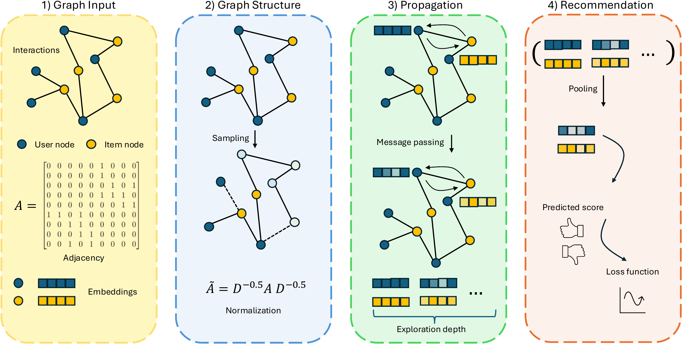
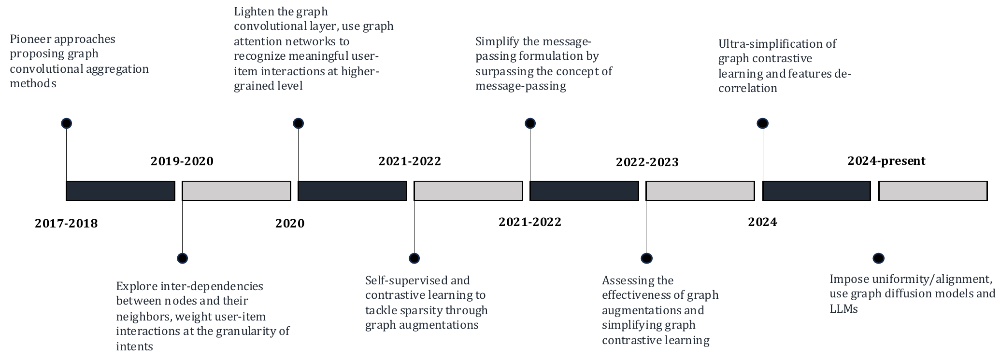
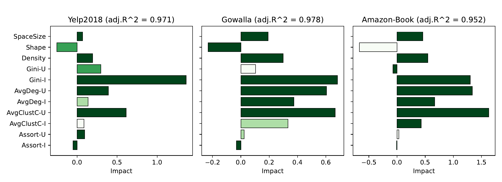

# On the Impact of Graph Neural Networks in Recommender Systems: A Topological Perspective

[](https://danielemalitesta.github.io/gnn-recsys-topology/)
[](https://arxiv.org/abs/2512.07384)
[](https://www.emerald.com/ftinr)

> Why do GNNs work so well for recommendation? We argue the answer lies in the **topology of the user–item graph**, and in how model architectures encode it.

🌐 **Website:** https://danielemalitesta.github.io/gnn-recsys-topology/ · 📄 **arXiv:** https://arxiv.org/abs/2512.07384

## 📰 News

**October 2026** 🎉 The monograph has just been **accepted for publication in [*Foundations and Trends® in Information Retrieval*](https://www.emerald.com/ftinr)** (Emerald Publishing). It will be officially published in **early 2027**. In the meantime, the full manuscript is available on [arXiv](https://arxiv.org/abs/2512.07384).

## Abstract

In recommender systems, user–item interactions can be modeled as a **bipartite graph**, where user and item nodes are connected by undirected edges. This graph-based view has motivated the rapid adoption of graph neural networks (GNNs), which often outperform collaborative filtering (CF) methods such as latent factor models, deep neural networks, and generative strategies. Yet, despite their empirical success, the reasons why GNNs offer systematic advantages over other CF approaches remain only partially understood.

This monograph advances a **topology-centered perspective** on GNN-based recommendation. We argue that a comprehensive understanding of these models' performance should consider the structural properties of user–item graphs and their interaction with GNN architectural design. To support this view, we introduce a formal **taxonomy** that distills common modeling patterns across eleven representative GNN-based recommendation approaches and consolidates them into a unified conceptual **pipeline**.

We further formalize thirteen **classical and topological characteristics** of recommendation datasets and reinterpret them through the lens of graph machine learning. Using these definitions, we analyze the considered GNN-based recommender architectures to assess how and to what extent they encode such properties. Building on this analysis, we derive an **explanatory framework** that links measurable dataset characteristics to model behavior and performance.

Taken together, this monograph re-frames GNN-based recommendation through its topological underpinnings and outlines open theoretical, data-centric, and evaluation challenges for the next generation of topology-aware recommender systems.

| 11 | 13 | 6 | 1,800 |
|:-:|:-:|:-:|:-:|
| GNN models re-interpreted | dataset characteristics | reference datasets | sampled graphs in the explanatory framework |

## Contents

| # | Chapter | What it covers | PDF |
|:-:|---|---|:-:|
| – | Front matter | Title page, contents, abstract | [PDF](docs/assets/pdf/00-front-matter.pdf) |
| 01 | Introduction | Motivation, notation, the six reference datasets and eleven reference models | [PDF](docs/assets/pdf/01-introduction.pdf) |
| 02 | Background on graph neural networks | Graphs, message passing, GCN and GAT, link prediction | [PDF](docs/assets/pdf/02-background-gnns.pdf) |
| 03 | The graph CF recommendation pipeline | Graph input → graph structure → propagation → recommendation; taxonomy of NGCF, DGCF, LightGCN, SGL, UltraGCN, GFCF, SVD-GCN, SimGCL, LightGCL, GraphAU, XSimGCL | [PDF](docs/assets/pdf/03-graph-cf-pipeline.pdf) |
| 04 | Classical dataset characteristics | Space size, shape, density/sparsity, Gini coefficients | [PDF](docs/assets/pdf/04-classical-characteristics.pdf) |
| 05 | Topological dataset characteristics | Node degree, clustering coefficient, degree assortativity, degree distribution, re-interpreted for RecSys | [PDF](docs/assets/pdf/05-topological-characteristics.pdf) |
| 06 | Topological characteristics in GNN-based recommendation | Which topological properties each model encodes, explicitly or implicitly | [PDF](docs/assets/pdf/06-topology-in-gnn-recsys.pdf) |
| 07 | Understanding the impact: an explanatory framework | Graph sampling, feature computation, training, and a linear explanatory model | [PDF](docs/assets/pdf/07-explanatory-framework.pdf) |
| 08 | Recent trends in GNN-based recommendation | Spectral methods (FPSR/FPSR+, spectral denoising), multimodal and LLM-enhanced recommendation (LLMRec) | [PDF](docs/assets/pdf/08-recent-trends.pdf) |
| 09 | Take-home messages | Lessons on architectures, data characteristics and topology | [PDF](docs/assets/pdf/09-take-home-messages.pdf) |
| 10 | Challenges and future directions | Theoretical, data-centric, task-specific and methodological challenges | [PDF](docs/assets/pdf/10-challenges-future-directions.pdf) |
| – | References | | [PDF](docs/assets/pdf/11-references.pdf) |

## Topology, re-interpreted

| Property | Symbol | Meaning in recommendation |
|---|:-:|---|
| **Node degree** | $\sigma_\mathcal{U}, \sigma_\mathcal{I}$ | User activity and item popularity; low degrees signal cold-start users and niche items. |
| **Clustering coefficient** | $\gamma_\mathcal{U}, \gamma_\mathcal{I}$ | Overlap between neighborhoods of same-type nodes: the essence of the collaborative filtering signal. |
| **Degree assortativity** | $\rho_\mathcal{U}, \rho_\mathcal{I}$ | Whether users (items) with similar activity (popularity) gather together: a broader, look-ahead property. |
| **Degree distribution** | $P(d) \sim d^{-\theta}$ | User–item graphs are scale-free: many low-degree nodes and a few hubs that feed popularity bias. |

> **Key finding.** GNN-based recommenders **explicitly** encode node degree in their formulations (through the $1/\sqrt{\sigma_u}\sqrt{\sigma_i}$ normalization), while clustering coefficient and degree assortativity are captured only **implicitly**, as emergent effects of multi-hop message passing.

## Selected figures

**The graph CF pipeline.** Graph input, graph structure, propagation, and recommendation.



**A (non-exhaustive) timeline of graph CF.**



**The explanatory framework in action** (LightGCN). Impact of each dataset characteristic on Recall@20; darker bars are more statistically significant. Results from our [RecSys 2024 paper](https://dl.acm.org/doi/10.1145/3640457.3688070). More models are shown on the [website](https://danielemalitesta.github.io/gnn-recsys-topology/#figures).



## Take-home messages

- **Simplicity often outperforms complexity.** Dropping non-linearities and feature transformations (NGCF → LightGCN) improves both accuracy and efficiency.
- **Over-smoothing is the main bottleneck.** It restricts most models to shallow depths and harms novelty and diversity.
- **GNNs can amplify popularity bias.** Performance correlates positively with item-side Gini: models reward popular items.
- **Denser data, better models; too many users can hurt.** Density relates positively to performance, shape inversely.
- **Node degree is foundational.** The factorization component and node degree are the most consistent predictors of performance.
- **Higher-order topology explains differences.** Exploiting clustering and assortativity is what often separates GNN architectures.
- **→ Make topological analysis a standard step.** Before costly training cycles, analyze the user–item graph to set realistic expectations and guide model selection.

## Authors

| | |
|---|---|
| **Daniele Malitesta** | LUISS Guido Carli University |
| **Alberto Carlo Maria Mancino** | Politecnico di Bari |
| **Claudio Pomo** | Politecnico di Bari |
| **Vito Walter Anelli** | Politecnico di Bari |
| **Alejandro Bellogín** | Universidad Autónoma de Madrid |
| **Tommaso Di Noia** | Politecnico di Bari |

## Contact

Questions, comments or collaboration ideas? Contact **Daniele Malitesta** at `d.malitesta [at] gmail [dot] com`.

## Citation

The official *Foundations and Trends® in Information Retrieval* reference will appear here upon publication (early 2027). For now, please cite the arXiv preprint, together with our RecSys 2024 paper below:

```bibtex
@article{malitesta2025impact,
  title         = {On the Impact of Graph Neural Networks in Recommender Systems: A Topological Perspective},
  author        = {Malitesta, Daniele and Pomo, Claudio and Anelli, Vito Walter and Mancino, Alberto Carlo Maria and Bellog{\'i}n, Alejandro and Di Noia, Tommaso},
  journal       = {arXiv preprint arXiv:2512.07384},
  year          = {2025},
  eprint        = {2512.07384},
  archivePrefix = {arXiv},
  primaryClass  = {cs.IR},
  url           = {https://arxiv.org/abs/2512.07384}
}
```

This monograph builds upon and extends our previous work, which first introduced the topology-aware evaluation of GNN-based recommender systems and the explanatory framework. **If you use or refer to this monograph, please also cite our RecSys 2024 paper** ([ACM DL](https://dl.acm.org/doi/10.1145/3640457.3688070)):

```bibtex
@inproceedings{malitesta2024novel,
  title     = {A Novel Evaluation Perspective on GNNs-based Recommender Systems through the Topology of the User-Item Graph},
  author    = {Malitesta, Daniele and Pomo, Claudio and Anelli, Vito Walter and Mancino, Alberto Carlo Maria and Di Noia, Tommaso and Di Sciascio, Eugenio},
  booktitle = {Proceedings of the 18th ACM Conference on Recommender Systems (RecSys '24)},
  pages     = {549--559},
  publisher = {ACM},
  year      = {2024},
  doi       = {10.1145/3640457.3688070},
  url       = {https://dl.acm.org/doi/10.1145/3640457.3688070}
}
```

## Website

The project page lives in [`docs/`](docs/) and is served by GitHub Pages (no build step: plain HTML/CSS/JS). To preview it locally:

```bash
python3 -m http.server -d docs 8000
```

## Acknowledgments

The website was inspired by the companion page of the survey [Graph Learning](https://fxia61.github.io/graphlearning/). We thank its authors for the idea of presenting a long-form monograph through an accessible web page.

## Disclaimer

This website (and this README) was entirely generated with [Claude](https://claude.ai) (Anthropic) and may contain errors. The monograph itself is the authoritative reference: in case of any discrepancy, please refer to the PDF.
